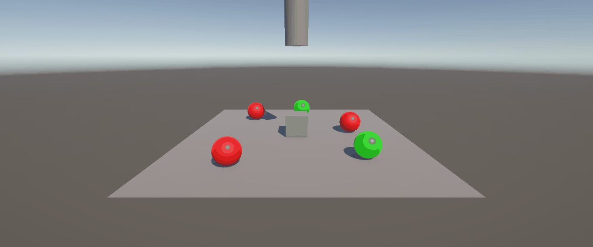
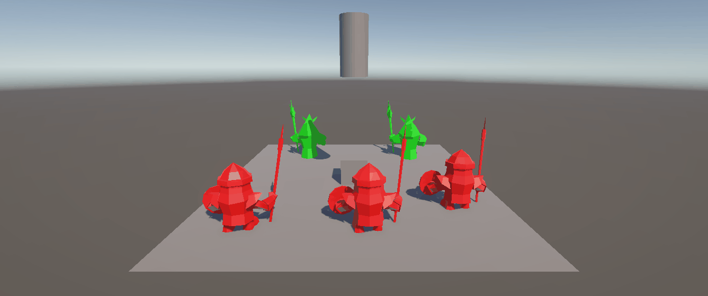
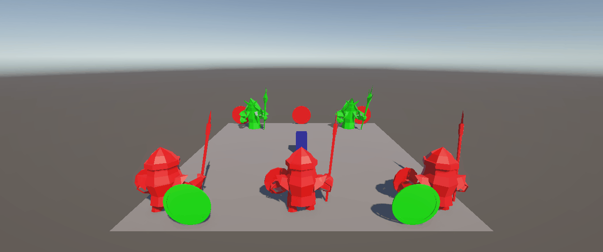
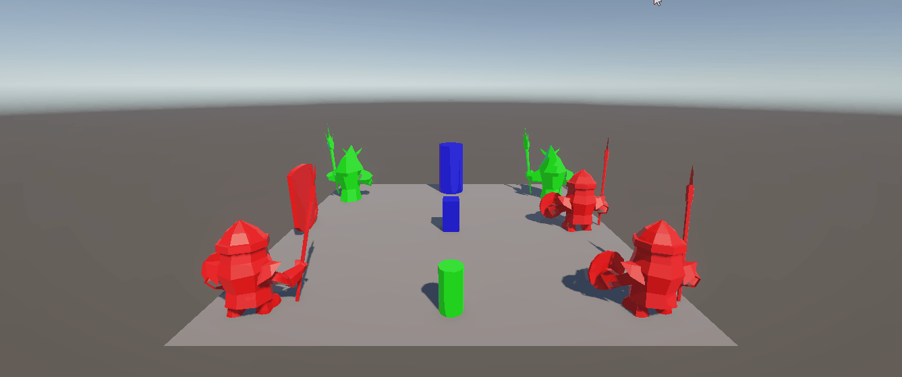
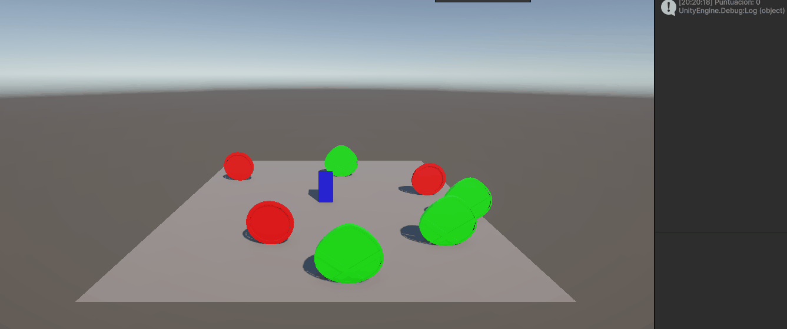
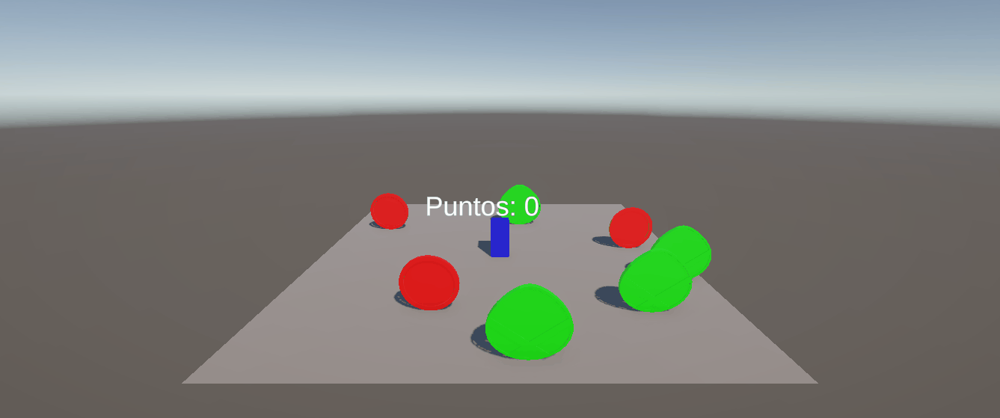

# Práctica 4: Eventos, Físicas y Notificaciones en Unity

**Asignatura:** Interfaces Inteligentes  
**Titulación:** Grado en Ingeniería Informática — Universidad de La Laguna (ULL)  
**Autor:** Bruno Morales Hernández — alu0101664309@ull.edu.es  
**Fecha:** Octubre 2026  

---

## Descripción General

El propósito principal de esta práctica es profundizar en la integración del motor de físicas 3D de Unity junto con arquitecturas orientadas a eventos mediante **delegados y eventos en C#** (Patrón Observador). A través de una batería progresiva de ejercicios, se abordan la comunicación desacoplada entre objetos ante impactos o triggers, la sustitución e interacción con modelos humanoides, mecánicas de recolección con actualización de interfaz gráfica (UI) y la coexistencia de entidades físicas dinámicas y cinemáticas.

---

## Estructura del Repositorio

```text
.
├── Assets/
│   ├── Scenes/
│   │   └── SampleScene.unity      
│   ├── Scripts/                   
│   │   ├── NotificadorCilindro.cs
│   │   └── SuscriptorEsfera.cs
│   └── Settings/                  
├── docs/
│   └── gifs/                      
│       └── ejercicio-01.gif
├── Packages/                      
├── ProjectSettings/               
└── README.md                      
```

---

## Ejercicios y Soluciones Técnicas

### Ejercicio 1: Coordinación de esferas mediante el Patrón Observer

Para resolver este ejercicio se implementa una arquitectura desacoplada basada en el **Patrón Observer** (publicador-suscriptor) utilizando los delegados (`delegate`) y eventos (`event`) nativos de C#. En lugar de que el objeto que detecta el impacto tenga que conocer y buscar manualmente a cada una de las esferas en la escena, el **Cilindro actúa como emisor (*Publisher*)**, disparando el evento `onCuboChoca` dentro del callback de colisión física `OnCollisionEnter` cuando valida que el cuerpo que contacta con él es el Cubo.

Las esferas, por su parte, actúan como **oyentes (*Subscribers*)** mediante el script `SuscriptorEsfera`. Al iniciarse la escena se suscriben al evento del cilindro, asociando su propia función callback. Cuando el cilindro notifica el impacto, todas las esferas activan su estado de marcha de manera reactiva y se desplazan frame a frame en `Update` mediante `Vector3.MoveTowards`: las de tipo 1 (rojas) convergen hacia la esfera de tipo 2 de referencia, mientras que las de tipo 2 (verdes) se dirigen hacia el propio cilindro.

* **Componentes y conceptos clave:**
  * **Físicas:** `OnCollisionEnter`, `BoxCollider` y `Rigidbody` dinámico en el Cubo para disparar la colisión.
  * **Arquitectura C#:** `delegate` y `event` para garantizar un acoplamiento nulo entre el cilindro y los objetos que reaccionan.
  * **Movimiento cinemático:** `Vector3.MoveTowards` con `Time.deltaTime` para un avance lineal constante y freno exacto en destino.



---

### Ejercicio 2: Sustitución de primitivas por modelos humanoides

Para este ejercicio cambiamos las esferas básicas por modelos 3D de humanoides, manteniendo exactamente la misma lógica de eventos que ya teníamos montada. El objetivo principal es ver cómo una arquitectura desacoplada nos permite cambiar la parte visual por completo sin tener que reescribir el comportamiento. A cada uno de estos nuevos personajes se le ajusta un `BoxCollider` a su cuerpo para delimitar su volumen y se le vuelve a asignar el script del suscriptor.

El funcionamiento en escena es el mismo que en el ejercicio anterior: cuando el cubo choca contra el cilindro, se lanza el evento y los personajes reaccionan. Los humanoides de tipo 1 (rojos) empiezan a caminar hacia el humanoide de tipo 2 (verde) que tenemos fijado como referencia, y los de tipo 2 (verdes) se desplazan directos hacia el cilindro. Al estar todo separado mediante delegados, no hizo falta tocar la lógica de comunicación para adaptarla a los nuevos modelos.

* **Componentes y conceptos clave:**
  * **Adaptación de geometrías:** Sustitución de primitivas por modelos tridimensionales ajustando sus colisionadores (`BoxCollider`) al volumen del cuerpo.
  * **Reutilización y desacoplamiento:** Mantenimiento de la arquitectura de eventos y delegados de C# sin cambios en el código lógico, validando la independencia entre vista/modelo y lógica.
  * **Traslación y orientación:** Desplazamiento reactivo de los avatares hacia sus objetivos fijados mediante `Vector3.MoveTowards`.



---

### Ejercicio 3: Notificación selectiva entre grupos y colisión con escudos

En este ejercicio ampliamos la mecánica basada en el patrón Observer para gestionar dos grupos de entidades independientes: humanoides del tipo 1 (Footman) y del tipo 2 (FreeLich), junto con dos tipos de escudos en la escena. Ahora el emisor del evento pasa a ser el propio Cubo mediante el script `NotificadorCubo`. Cuando el cubo se desplaza con las teclas y colisiona físicamente contra un personaje, discrimina a qué grupo pertenece en `OnCollisionEnter` revisando el nombre del objeto (`Footman` o `FreeLich`) y lanza el evento correspondiente: `onCuboChocaGrupo1` o `onCuboChocaGrupo2`.

La lógica de respuesta está cruzada entre ambos bandos. Los humanoides del grupo 1 (Footman) se suscriben al evento que avisa cuando el cubo impacta a un rival del grupo 2; al recibirlo, inician su desplazamiento hacia el escudo de tipo 1 seleccionado. Por su parte, los del grupo 2 (FreeLich) escuchan el choque contra el grupo 1 y avanzan hacia los escudos del grupo 2. Además, durante el desplazamiento en `Update`, cada humanoide comprueba frame a frame si su volumen o malla entra en contacto con la del escudo objetivo (evaluando la intersección de sus colisionadores). En cuanto se detecta dicho contacto, se modifica el material del modelo a través de su `Renderer`: los del grupo 1 cambian su color a **amarillo**, mientras que los del grupo 2 pasan a color **violeta**.

* **Componentes y conceptos clave:**
  * **Eventos diferenciados:** Declaración de múltiples eventos (`onCuboChocaGrupo1` y `onCuboChocaGrupo2`) para coordinar respuestas cruzadas e independientes entre ambos grupos.
  * **Discriminación en colisión:** Filtrado en `OnCollisionEnter` mediante comprobación de subcadenas en los nombres de las instancias para saber qué delegado invocar.
  * **Físicas y control del jugador:** Desplazamiento cinemático con `rb.position` en `FixedUpdate` para interactuar de forma sólida con los personajes.
  * **Comprobación geométrica y respuesta visual:** Verificación de solapamiento de mallas/colisionadores en `Update` y cambio dinámico de color en el `Renderer` (amarillo para el grupo 1 y violeta para el grupo 2) al alcanzar el escudo.



---

### Ejercicio 4: Detección por proximidad, teletransporte y orientación

En este ejercicio cambiamos la forma de activar el evento: en lugar de esperar a un choque físico directo, la interacción se dispara por proximidad geométrica. Para ello, el cilindro actúa como objeto de referencia y emisor a través del script `NotificadorReferencia`. En su método `Update`, calcula en cada frame la distancia euclídea que lo separa del cubo con `Vector3.Distance`; en cuanto el jugador cruza el umbral establecido (`distanciaActivacion`), se lanza el evento `onProximidadDetectada`.

A partir de esta única señal, volvemos a aplicar el patrón Observer para obtener respuestas totalmente distintas según el tipo de humanoide. Los del grupo 1 tienen asociado `SuscriptorTPGrupo1`, de modo que al activarse el evento se teletransportan al instante igualando su posición a la del escudo objetivo (`transform.position = objetivo.transform.position`). Por su parte, los del grupo 2 utilizan `SuscriptorOrientaGrupo2` y no se desplazan, sino que reaccionan rotando su orientación hacia un objeto de la escena mediante `transform.LookAt`.

* **Componentes y conceptos clave:**
  * **Activación por proximidad:** Cálculo continuo de distancia euclídea (`Vector3.Distance`) en `Update` como alternativa matemática a los colisionadores de tipo Trigger.
  * **Patrón Observer con respuestas heterogéneas:** Un mismo evento dispara lógicas independientes según la entidad suscrita (traslación instantánea vs reorientación espacial).
  * **Manipulación de `Transform`:** Modificación directa de coordenadas para el teletransporte y empleo de `transform.LookAt` para enfocar el frente del modelo hacia el objetivo.



---

### Ejercicio 5: Mecánica de recolección y acumulación de puntuación

En este ejercicio se implementa un sistema básico de recolección de objetos (escudos) y conteo de puntos utilizando detección de colisiones físicas. El comportamiento se reparte entre dos scripts independientes asociados a cada entidad: el jugador (cubo) y los escudos presentes en la escena.

Por un lado, el jugador lleva el script `JugadorRecolector`, que mantiene una variable entera interna `puntuacion`. Cada vez que el cubo choca contra un objeto, su método `OnCollisionEnter` evalúa el nombre de la entidad colisionante: si corresponde a un escudo `Tipo1` suma 5 puntos, y si es de `Tipo2` suma 10 puntos, mostrando inmediatamente el total actualizado por la consola de Unity mediante `Debug.Log`. Por otro lado, cada escudo cuenta con el script `EscudoPuntuacion`, el cual detecta en su propio `OnCollisionEnter` el choque con el objeto denominado `"jugador"` y ejecuta `Destroy(gameObject)` para eliminarse de la escena y simular que ha sido recogido.

* **Componentes y conceptos clave:**
  * **Detección física bidireccional:** Empleo de `OnCollisionEnter` en ambos extremos para separar la lógica de puntuación (en el jugador) del ciclo de vida del objeto (en el escudo).
  * **Filtrado por nomenclatura:** Uso de `name.Contains()` para discriminar el tipo de ítem impactado y asignar la puntuación correspondiente de forma directa.
  * **Ciclo de vida y destrucción:** Llamada a `Destroy(gameObject)` para retirar las instancias de la jerarquía de la escena tras el contacto.
  * **Depuración:** Registro en tiempo real del progreso acumulativo mediante `Debug.Log`.



---

### Ejercicio 6: Interfaz gráfica de puntuación con Canvas y TextMeshPro

En este ejercicio sustituimos la salida por consola del ejercicio anterior por una interfaz de usuario (HUD) integrada en la pantalla mediante un `Canvas`. Para ello se crea el script `JugadorRecolectorUI`, el cual centraliza tanto la recolección y destrucción de los escudos como la actualización visual del marcador en tiempo real empleando la librería `TMPro` (`TextMeshPro`).

Al arrancar la escena, el método `Start` llama a `ActualizarMarcador()` para inicializar el texto en pantalla con la puntuación a cero (`"Puntos: 0"`). Durante la partida, cada vez que el cubo colisiona con un escudo, `OnCollisionEnter` discrimina si se trata de un escudo `Tipo1` (+5 puntos) o `Tipo2` (+10 puntos), suma los puntos correspondientes, refresca el componente `TMP_Text` asignado en el Inspector y procede a destruir el escudo recogido (`Destroy(collision.gameObject)`), ofreciendo una respuesta visual inmediata al jugador.

* **Componentes y conceptos clave:**
  * **Sistema de UI de Unity:** Uso de `Canvas` como contenedor de la interfaz y elementos `TextMeshPro - Text` (`TMP_Text`) para una representación nítida del texto en pantalla.
  * **Sincronización del estado de juego:** Actualización inmediata de la vista (UI) en el mismo instante en que se modifica la lógica de puntuación.
  * **Centralización de la recolección:** Detección de colisión, cálculo de puntos, refresco del marcador y destrucción del coleccionable unificados en un único flujo de ejecución dentro de `OnCollisionEnter`.

